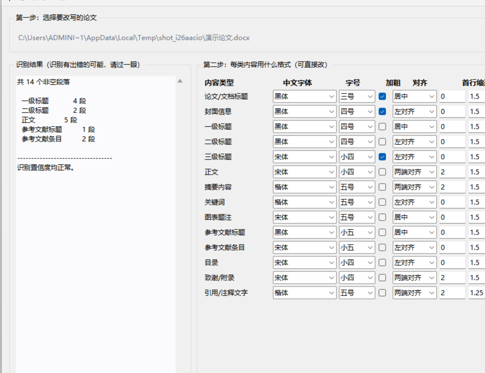

# 手动调论文格式？一键搞定！

[](https://github.com/BrandonLHY/thesis-format-toolkit/actions/workflows/selftest.yml)
[](LICENSE)
[](https://www.python.org/downloads/)

**论文格式改写器** · 把 Word 论文按格式规范重新排版，不修改你的原文件

---

Word 论文的格式要求是几十条硬指标：一级标题四号黑体、正文小四号宋体、
行距 1.5 倍、参考文献小五号……而且**必须逐个段落设**，漏掉一处就要从头查。

更麻烦的是：你肉眼看到的「一、引言」和「（一）基本情况」长得差不多，
在文档内部却可能是完全不同的东西——有的挂了命名样式，有的是直接设置格式，
有的是 WPS 自动编号，还有的只是纯文字。手工调的时候，你根本不知道自己在改什么。

**这个工具做两件事：先看清每段是什么，再按你的标准统一改掉。**



*左侧是识别结果（14 种内容类型各有多少段），右侧可以逐类调整字体字号、对齐、缩进、行距。*

- **门槛低** —— 已写好的 Word 稿直接交进来，不用学 LaTeX、不用换模板重写
- **Windows / macOS 都能用** —— 多数同类工具只有 Windows 版
- **不修改原文件** —— 只读取，结果写到新文件。改坏了原稿还在
- **本地运行** —— 不联网、不上传任何内容
- **格式可自定义** —— 字体字号在界面上改，不用动代码
- **规范可替换** —— 换学校只需新增一个 JSON，程序不用改
- **六套自检** —— 共 254 项，三平台 CI 自动运行

> **和其他方案差在哪？** 见 [与其他方案的区别](#和其他方案的区别)——
> 一句话：不用学新东西，把你手里的 Word 稿交进来就行；Mac 上也能跑。

---

## 快速开始

### 方式一：用打包好的程序（Windows）

1. 下载 Release 里的压缩包，解压到**有写权限的目录**
2. 双击 `论文格式改写器.exe`
3. 选论文 → 核对识别结果 → 调整格式 → 生成新文档

> 放在 `C:\Program Files` 下会因权限问题无法保存设定。
> 首次运行可能被 SmartScreen 提示「未知发布者」，点「更多信息」→「仍要运行」。

### 方式二：从源码运行

```bash
pip install -r requirements.txt
python main.py
```

需要 Python 3.10 或更高版本。

**macOS 也支持从源码运行**：字体处理会自动把「宋体」等 Windows 字体名
替换成系统里存在的 Songti SC 等。每次提交都会在 GitHub Actions 的
macOS 真机上跑一遍字体探测与文档处理检验（见下方「没有 Mac 电脑，怎么测 macOS 适配」）。

不提供 Mac 成品下载——PyInstaller 无法跨平台打包，`.app` 只能在 Mac 上生成。

### 方式三：命令行

```bash
# 改写（默认会重排标题编号、处理上标）
python rewrite_cli.py 论文.docx 输出.docx

# 保留原有标题编号
python rewrite_cli.py 论文.docx 输出.docx --keep-numbering

# 不做上标处理
python rewrite_cli.py 论文.docx 输出.docx --no-superscript --no-note-marks
```

---

## 它会改什么

| 项目 | 说明 |
|---|---|
| 字体字号 | 中文/西文字体、字号、加粗，按内容类型分别设置 |
| 段落格式 | 对齐、首行缩进（字符单位）、行距、段前段后 |
| 标题编号 | 把 WPS/Word 的自动编号转成文字编号，按章重置（可选） |
| 上标 | 正文引用 `[1]` 与注释序号 `①②` 设为上标；参考文献条目里的 `[n]` 不动 |
| 跨平台字体 | 在 macOS 上自动把「宋体」替换成系统存在的 Songti SC 等 |

**不改动文字内容。** 唯一的例外是你主动开启「重排标题序号」时，
它会在标题前补写编号（如「二、相关概念和理论」）。

---

## 适用边界（请先读）

这个工具不是万能的，写清楚免得你白费时间。

**表现好的情况：**

- 论文有**编号**（一、／（一）／1、）或作者用过 Word 的标题样式
- 结构相对清晰，章节层次分明

**表现会退化的情况：**

- **完全没有编号的纯文本稿**：如果一段文字既没有编号、也没有加粗、
  字号也和其他段落一样，程序只能靠语义猜测，会出错
- 层级逻辑本身混乱的稿子（例如「研究背景」既可能是一级标题也可能是二级标题）

**实测数据：** 以 Word 自身的大纲级别（`w:outlineLvl`）为基准，
在一份 138 段的真实论文上，区域识别**精确率 86%、召回率 97%**。

**因此界面上会显示识别结果让你核对**，而不是直接闷头改完给你。
识别有疑问的段落会标出来。

**不覆盖的内容：**

- 分页渲染类要求（图题不拆页、表格跨页续表标注）
- 公式的居中与编号位置
- 目录页码自动刷新（需在 Word 里按 F9）
- 旧版 `.doc` 格式（需先另存为 `.docx`）

---

## 和其他方案的区别

### 最要紧的两点：门槛低，Mac 也能用

**一、门槛低——你已经写好的稿子直接交进来就行。**

不用学 LaTeX，不用换模板重写，不用把内容一段段搬到别的地方，
**也不要求你的标题样式是规范的**。

论文排版常见几条路，各有代价：

| 方案 | 你要付出什么 |
|---|---|
| 用学校发的 Word 模板 | 得在模板里从头写，或把已有内容一段段套样式 |
| 用 LaTeX 模板（thuthesis、njuthesis 等） | 要用 LaTeX 重写一遍，学习成本高 |
| 在线排版 / 格式转换服务 | 论文要上传到别人的服务器 |
| Word 查找替换、样式刷、宏 | 前提是作者的标题样式已经规范；样式一乱就失效 |
| 通用格式转换工具（如 pandoc） | 解决的是「格式互转」，不判断某一段到底是什么内容 |

这个工具针对的是最常见的那种处境：**你已经用 Word 写完了，格式不合规。**

它做的不是「套模板」，而是**先判断每段是什么，再改格式**：

- 综合多个线索判断每段角色——编号形式（一、／（一）／1、）、大纲级别、
  字号、字体、加粗、居中、文本长度、结构词——而不是
  「有 Heading 1 样式的就是一级标题」
- 这一点很关键：**多数学生初稿根本没用过 Word 的标题样式**，
  全靠手打和手动加粗。模板类和样式刷类工具在这种稿子上直接失效
- 实测：以 Word 自身的大纲级别为基准，在一份 138 段的真实论文上，
  区域识别**精确率 86%、召回率 97%**
- **判断结果会先摆给你看**——左侧列出每类内容各有多少段，
  确认无误再改写，不是黑盒跑完丢给你一个文件

上手成本：

| 平台 | 你需要做 | 需要装什么 |
|---|---|---|
| **Windows** | 解压，双击 `论文格式改写器.exe` | 什么都不用装（自带运行环境） |
| **macOS** | 打开终端跑三行命令 | Python 3.10+（系统通常自带或一行装好） |

Windows 上不需要 Python、不需要 Office、不需要注册账号。

**二、Mac 也能用——多数同类工具只有 Windows 版。**

中文论文排版工具的常见实现方式是调 WPS/Word 的 COM 接口、写 VBA 宏，
或依赖 Windows 专有组件——**这些在 macOS 上根本跑不起来**。

这个工具从源码就能在 Mac 上运行，而且做了实际的平台适配：

- **字体自动替换**——macOS 没有「宋体/黑体」，程序会自动换成系统里存在的
  Songti SC / Heiti SC 等，并保证不会写入系统里不存在的字体名
- **候选链兜底**——「仿宋」这类 macOS 上确实没有对应字体的，
  有明确记录的降级方案（README 里写明了取舍）
- **真机 CI 验证**——每次提交都在 GitHub Actions 的 macOS 真机上跑一遍
  字体探测与文档处理检验，三个平台（Windows / Ubuntu / macOS）全绿

**诚实说明**：Mac 上目前是**源码运行**，不提供成品下载——
PyInstaller 无法跨平台打包，`.app` 只能在 Mac 上生成。
所以 Mac 用户的门槛比 Windows 用户高一档（要敲命令）。
如果你有 Mac 且不想敲命令，可以提 issue，我们看看有没有别的办法。

### 其他区别

**全程离线，不联网、不上传任何内容。**
论文是未发表的成果，传到别人服务器上本身就是风险。
这是架构决定的事实，云端方案做不到。

**不修改原文件。** 只读取，结果写到新文件。改坏了原稿还在。

**WPS / Word 自动编号转文字编号。**
中文论文里的自动编号经常出问题（跨章不重置、导出后编号丢失）。
这个工具把它转成文字编号并按章重置。
同类工具的介绍里我们没见过这一项——**如有反例欢迎指出**。

**体检与改写用同一套规范。**
附带的只读体检工具先告诉你哪里不合规，再按同一套规范改写，
不会出现「检查标准」和「改写标准」不一致的情况。

**换学校只需新增一个 JSON。** 格式规范与代码分离，
`specs/` 目录下换个文件即可，程序不用改。

**六套自检共 254 项，三平台 CI。**
在 Windows / Ubuntu / macOS 上自动运行。这不是装饰——
开发过程中它抓出过多个真实缺陷（见「自检实际发现过的缺陷」一节）。

### 这个工具不做什么

写清楚，免得你白费时间：

- **不管内容对错**——它只改格式，一个字都不动
- **不管分页渲染**——图题不拆页、表格跨页续表标注这类要求做不到
- **不做公式精排**
- **不支持旧版 `.doc`**——需先用 Word/WPS 另存为 `.docx`
- **不自动刷新目录页码**——生成后需在 Word 里按一下 F9

---

## 自定义格式

界面底部可以调整每个内容类型的字体、字号、加粗、对齐、缩进、行距。
改完自动保存到程序目录下的 `预设.json`，下次打开还在。

换学校/换规范，只需新增一个 JSON 文件到 `specs/`，结构参见
[specs/sysu_undergraduate_thesis.json](specs/sysu_undergraduate_thesis.json)。

```jsonc
{
  "elements": {
    "正文": {
      "font_ea": "宋体",           // 中文字体
      "font_ascii": "Times New Roman",
      "pt": 12.0,                  // 字号（磅），小四 = 12
      "bold": false,
      "raw": "小四号宋体",          // 规范原文，报告里展示
      "extra_rules": ["首行缩进2字符"]
    }
  },
  "page": { "width_mm": 210.0, "margin_top_mm": 25.4, "tolerance_mm": 1.0 },
  "line_spacing": { "allowed": [{ "label": "1.5倍", "line": 360 }] }
}
```

---

## 附带：格式合规体检工具

仓库里还有一个**只读**的检查工具，按规范逐段打分，输出带定位的 HTML 报告。

```bash
python audit_engine.py 论文.docx specs/sysu_undergraduate_thesis.json
python report_html.py 论文.docx specs/sysu_undergraduate_thesis.json 报告.html
```

它检出的是「哪里不符合规范」，不做修改。适合投稿前自查。

---

## 自检

**六套自检，共 254 项**，每次 push 由 CI 自动运行。
当前 CI 在 **Windows + Ubuntu + macOS** 三个平台上全部通过
（Python 3.10/3.12）。

```bash
python run_all_selftests.py     # 一键跑全部并汇总
```

单独运行：

```bash
python 验收检验.py                # 37 项：模拟全新用户走完整流程
python selftest_adversarial.py   # 39 项：畸形输入的健壮性
python selftest_fidelity.py      # 39 项：输出保真度与元数据保全
python selftest_synthetic.py     # 36 项：假想论文端到端
python selftest_platform.py      # 18 项：字体替换行为
python selftest_fontparse.py     # 74 项：字体解析（含 macOS 录制回放）
python main.py --selftest        # 11 项：依赖、GUI、端到端
python selftest_macos_live.py    # macOS 真机诊断（非 macOS 自动跳过）
python selftest_macos_sim.py     # 在任意平台模拟 macOS 跑上面全部套件
```

### 各套覆盖什么

| 套件 | 重点 |
|---|---|
| **验收检验** | 依赖 → 造论文 → 识别 → 改写 → 核对字体/编号/上标/文字完整性/原文件安全/GUI |
| **对抗性 A** | 空文档、仅空白、段落无 run、超长标题、重复编号、表格内段落、含图片、项目符号列表、异常字号、坏样式引用、嵌套内容控件、**跨 run 上标**、全文单段、中英混排 |
| **对抗性 B** | 文档属性、页眉页脚、书签、域代码、内容控件、分节属性、纸张尺寸、媒体文件、空段落保留、幂等性、预设生效性、**run 内换行节点与引用标记共存** |
| **假想论文** | 纯文本段与有格式段、编号标题与无编号结构词、参考文献条目序号、全角括号、多引用区间、注释混排、年份区间、摘要标注同段 |
| **跨平台字体** | 字体名不含逗号、Windows 不替换、模拟 macOS 替换、探测失败降级、界面选项、**macOS `system_profiler` 输出的录制回放**、中文字体角色在 macOS 上都有可用候选 |
| **程序自检** | 打包后依赖完整、GUI 可构建、上标规则、端到端改写 |
| **macOS 真机诊断** | 在 macOS 上打印真实 `system_profiler` 调用实况与 JSON 结构、与录制夹具交叉比对、验证核心字体可用性。system_profiler 不可用时记为**环境限制**而非失败，改用字体目录扫描继续验证 |
| **macOS 环境模拟** | 在任意平台模拟 macOS（两种环境：探测正常 / 退回扫目录），跑上面全部套件，一次列出所有只在 macOS 上失败的断言 |

### 没有 Mac 电脑，怎么测 macOS 适配

macOS 适配的风险几乎全在**字体探测**上——`system_profiler SPFontsDataType -json`
的输出结构在不同 macOS 版本间不完全一致，字段还可能缺失。用三个办法覆盖：

1. **录制回放**（`selftest_fontparse.py`，74 项）
   把真实的 `system_profiler` 输出结构录下来存成
   `tests/fixtures/fonts_macos_real.json`，喂给解析函数做确定性断言。
   这样在 Windows 上也能测 macOS 的解析逻辑，还额外覆盖了畸形输入
   （截断的 JSON、字段为 null、类型不对等 12 种）。

2. **环境模拟**（`selftest_macos_sim.py`）
   在任意平台把平台标识、字体探测结果都替换成 macOS 的样子，
   再跑一遍全部套件，**一次列出所有「只在 macOS 上才会失败」的断言**。

   模拟两种环境，都要通过：

   | 模式 | 含义 |
   |---|---|
   | `profiler` | `system_profiler` 正常，拿到真实字体家族名 |
   | `dirscan` | `system_profiler` 失败，退回扫描目录，只有文件名 |

   **真机 runner 上是第二种**，所以这一种必须覆盖。
   实测教训：最初只模拟了第一种，结果真机连续失败三轮。

3. **免费的真机 CI**（GitHub Actions 的 `macos-latest` runner）
   公开仓库使用标准 runner 不收费。`selftest_macos_live.py` 在真机上打印
   `system_profiler` 的实际返回情况，与录制夹具交叉比对——
   **这样能确证夹具没有脱离现实**，避免「用错的夹具测出假的通过」。

**当前状态**：三个平台（Windows / Ubuntu / macOS）CI 全绿。

#### 这套办法确实抓到了一个真缺陷

不是 CI 环境问题，是程序缺陷：

受限环境里 `system_profiler` 会返回合法 JSON 但 `_items` 为空。
旧实现把 `SPFontsDataType` 那一层的 `_name`（区段标签「字体」/「Fonts」）
也当成了字体名，于是字体集合变成 `{"字体"}` —— **非空**，
导致「探测不到就退回扫描字体目录」的兜底不触发。
结果 `resolve_font()` 找不到任何候选，把 Windows 字体名原样写进文档，
Mac 版 Word 静默回退到别的字体。**也就是说：探测失败时不但没有降级，
反而伪装成探测成功。**

修复过程中还走过一段弯路，值得记下来：为了「只扫到文件名」的降级路径，
曾经加过前缀模糊匹配（想把 `songti` 认成 `Songti SC`）。但那套启发式
本质上是在猜，连续引入两个错误——`kaiti` 被认成 Windows 名 `KaiTi`、
`times` 被认成 `Times`。最终结论是
**文件名与字体家族名之间没有可靠的对应关系**，于是回退为只做精确匹配：
命中就用，命中不了就保持原名字（Word 会自行回退，与改造前行为一致），
绝不凭空写入一个系统里不存在的字体名。

**仍然测不到的**：字体名在 Mac 版 Word 里是否真能命中、界面在 Mac 上的实际外观、
`.app` 打包（PyInstaller 不能跨平台打包，只能在 Mac 上做）。
因此本项目对 macOS 的支持定位是**源码运行**，不提供 Mac 成品下载。

**已知取舍**：`仿宋` 的候选链原本全部落在 macOS 上不存在的名字上
（仿宋/FangSong/STFangsong/仿宋-简），已补上 `Kaiti SC` 兜底。
但 Kaiti SC 是楷体风格，**与仿宋不等价**，属于"保证有字体可用"的降级替代。

### 自检实际发现过的缺陷

这些不是设想出来的用例，每一条都对应一次真实修复：

| 缺陷 | 怎么被发现的 |
|---|---|
| `（一）` 二级标题被判成一级 | 验收检验（「黑体14pt + （一）前缀」这个组合） |
| **跨 run 的引用标记漏上标** | 对抗性检验 A |
| **上标切分会复制换行节点** | 外部用户复核（见下方说明） |
| **macOS 字体探测把区段标签当字体名** | macOS CI 真机测试（见上节说明） |
| 主题字体压制具体字体名 | 真实文档 + Word COM 读取实际字体 |
| 字体回退链在 Word 中无效 | 专门写实验验证假设，结果推翻了原方案 |
| `outlineLvl` 无 `val` 时整类标题漏检 | 分类器自检（「长度>50 的标题应为 0 个」） |
| run 对象身份比较导致标题文字被清空 | 逐层插桩追踪 |
| 分区无退出条件，吞掉 88 段正文 | 阅读输出时发现数字异常 |
| 目录区在内容控件内，从未被改写 | 对比 Word 报告的段落数与程序看到的段落数 |
| 打包缺 `docx/templates`，新建文档报错 | 打包后跑自检 |
| 单文件 exe 报临时目录错误，无法启动 | 实际运行 exe |

#### 关于「换行节点被复制」这个缺陷

同样一段正文里既有换行节点（`w:br`，Word 里的软回车）又有引用标记时，
上标处理需要把 run 切开，而旧实现是 `deepcopy` 整个 run 再删文字节点——
**把换行节点一并复制到了每一片**。一个含 2 个换行、1 个引用的 run 被切成数片后，
换行节点成倍增长，渲染出来行数暴增。

**自检为什么没抓到：** 文字完整性检查只统计 `w:t` 的文本长度，
而换行是节点结构不是字符，所以照样「通过」。这正是该缺陷阴险的地方——
**只有数换行节点数量才会露馅。**

这个缺陷由一位使用者独立复核发现，已修复并补上针对性的回归测试
（`selftest_fidelity.py` 第 7b 节，直接统计 `w:br` 节点数）。


---

## 开发过程中踩过的坑

这些是实测发现、且会导致错误结论的问题，都已修复并有自检覆盖：

| 坑 | 现象 | 处理 |
|---|---|---|
| **主题字体压制** | 写了具体字体名却无效，Word 报告为「+中文正文」 | `w:eastAsiaTheme` 与 `w:eastAsia` 同时存在时主题优先，必须先删主题引用 |
| **字体回退链无效** | 写入 `"宋体,Songti SC"` 以为会依次尝试 | Word 把整串当成**一个字体名**。必须运行时探测系统字体，只写存在的那个 |
| **`outlineLvl` 默认值** | 漏检全部某类标题 | `<w:outlineLvl/>` 无 `w:val` 时 OOXML 默认是 **0**（一级标题），当成 None 就漏了 |
| **run 对象身份比较** | 刚写入的标题文字立刻被清空 | python-docx 每次访问 `p.runs` 都新建包装对象，`r is not first` 永远为真，必须比较 XML 元素 |
| **分区没有退出条件** | 88 段正文被误判为「摘要内容」 | 前置区必须能被大标题打断 |
| **封面识别过宽** | 106 段的文档只剩 3 段参与判定 | 限定范围 + 保护名单 |
| **目录区看不到** | 目录 28 段从未被改写 | 目录在 `w:sdt` 内容控件内，`doc.paragraphs` 不返回 |
| **超链接里的 run 看不到** | 目录条目全部漏改 | `p.runs` 不含 `w:hyperlink` 内的 run |
| **参考文献序号误上标** | 条目 `[1]` 被当成正文引用 | 按区域区分：正文区上标，条目区不动 |
| **年份区间误上标** | `[2010-2015]` 被当引用 | 用数字位数区分（引用序号不超过 3 位） |
| **跨 run 的引用标记漏上标** | `"…的["` + `"4"` + `"]标记"` 三个 run，标记被拆开，逐 run 匹配全都看不到 | 改为按段落拼接文本定位标记，再映射回各 run |
| **判据优先级错误** | `（一）` 二级标题因字体是黑体14pt 被判成一级标题 | 编号模式必须优先于字号判据——编号是作者显式标注的层级 |
| **打包缺模板文件** | 打包后新建文档报 `PackageNotFoundError` | PyInstaller 的 `--collect-all` 没带上 `docx/templates`，必须显式 `--add-data` |
| **单文件 exe 打不开** | 报 `Could not create temporary directory` | 用 `--runtime-tmpdir` 让它解压到自身目录 |

---

## 项目结构

```
.
├── main.py                  程序入口（--selftest 自检）
├── app.py                   图形界面
├── rewrite_cli.py           命令行入口
├── rewriter.py              改写引擎 + 默认预设
├── region_detector.py       区域识别
├── numbering.py             标题编号处理
├── superscript.py           上标处理
├── platform_fonts.py        跨平台字体适配
├── audit_engine.py          合规体检引擎
├── report_html.py           体检报告渲染
├── environment_probe.py     运行环境探测（有无图形显示等）
├── build_exe.py             Windows 打包
├── selftest_*.py            自检
├── run_all_selftests.py     一键跑全部自检
├── specs/                   格式规范（可扩展）
├── tests/fixtures/          录制回放夹具（macOS 字体探测输出）
├── docs/                    打包与发布说明、开发笔记
└── .github/workflows/       CI（Windows + Ubuntu + macOS）
```

---

## 开发说明

本项目在开发过程中使用了 **AI 编程助手（DeepSeek Harness）** 辅助实现。

需求定义、产品形态设计、真实文档测试、问题定位与最终验收由作者完成。
代码由**六套自检共 254 项**覆盖，并在多份真实论文上验证——
上表列出的每一项已知缺陷，都来自真实使用中暴露的问题。

---

## 许可证

**GNU General Public License v3.0 or later** —— 见 [LICENSE](LICENSE)。

这意味着：你可以自由使用、修改、分发本程序，但**分发衍生作品时必须同样以 GPL 开源**。

依赖库许可证：`python-docx`（MIT）、`lxml`（BSD），均与 GPL 兼容。

---

## 关于格式规范的来源

`specs/sysu_undergraduate_thesis.json` 中的字号、页边距等**数值**来自
《中山大学本科生毕业论文格式要求》。规则的具体数值属于客观事实，
此处以机器可读的形式重新表达，便于程序使用。

其他学校/刊物只需按同样结构新增 JSON，**程序不需要修改**。
欢迎提交你所在院校的规范文件。

---

## 贡献

欢迎 issue 和 PR。提交前请先跑一遍全部自检：

```bash
python run_all_selftests.py
```

如果你有**识别错误的真实案例**，那是特别有价值的反馈——
请附上（脱敏后的）文档结构描述和你期望的识别结果。

打算改代码的话，建议先看 [docs/开发笔记.md](docs/开发笔记.md)——
里面记了 CI 怎么查才可靠、没有真机怎么测其他平台、
以及一批准会把项目改坏的坑（PowerShell 语法陷阱、字体名与文件名没有
可靠对应关系、诊断脚本不该把环境差异判成失败等）。

---

## 致谢

**金辉** —— 独立复核时发现了一个当时 175 项自检都没覆盖的真缺陷：
上标切分 run 时会连带复制换行节点（`w:br`），导致含软回车与引用标记的段落
渲染行数暴增。

这个缺陷的特殊之处在于**常规检查抓不到**：文字完整性只统计 `w:t` 的文本长度，
而换行是节点结构不是字符，所以照样「通过」。只有直接统计换行节点数量才会露馅。
他的复核指出了这一点，也促成了针对性回归测试的补上
（`selftest_fidelity.py` 第 7b 节）。

> 如果你也发现了问题，欢迎提 issue。**能指出「哪一类检查抓不到它」的反馈尤其宝贵**——
> 那往往意味着自检本身缺了一个维度，而不只是漏了一个用例。

